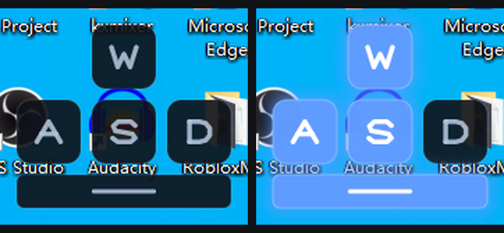
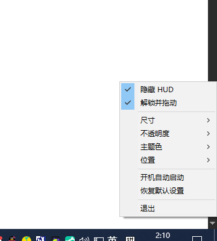
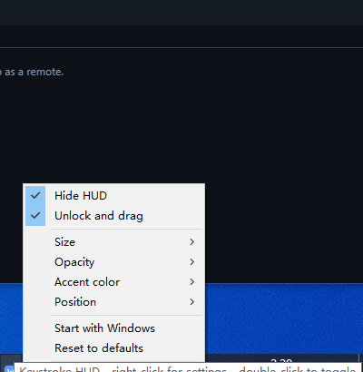
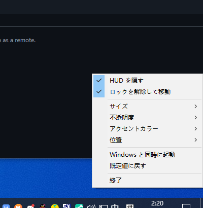

<div align="center">

# SimpleKeystroke

**A tiny portable keystroke HUD for Windows — truly transparent, always on top, 304 KB, zero dependencies.**

[English](README.md) · [简体中文](README.zh-CN.md) · [繁體中文](README.zh-TW.md) · [日本語](README.ja.md)

[](LICENSE)
[](https://www.rust-lang.org)
[](#requirements)
[](#)



<sub>Left: idle — Right: <kbd>W</kbd> <kbd>A</kbd> <kbd>S</kbd> <kbd>Space</kbd> held down</sub>

</div>

---

## What is it?

SimpleKeystroke draws a small keyboard on your screen (**W A S D** + **Space**) and lights up each key the instant you press it. It lives in the system tray, floats above every window, and is fully click-through — it never blocks your game, your editor, or your stream layout.

**Written in Rust.** No Electron, no .NET, no C++ runtime, no installer. The UI is hand-rasterized pixel by pixel into a Win32 layered window through `windows-sys`, then composited by DWM. The result is one self-contained executable with no DLLs and no admin rights.

Good for: stream overlays (OBS), screen recordings, tutorial videos, or simply watching your own movement keys while you play.

## Features

| Feature | Detail |
| :--- | :--- |
| **Truly transparent** | Per-pixel alpha via `UpdateLayeredWindow` — rounded corners and glow blend into whatever is behind, not a color-keyed box. |
| **Click-through** | While locked the window carries `WS_EX_TRANSPARENT`, so clicks pass straight through. |
| **Tray hosted** | No taskbar button, no frame, no title bar. Right-click the tray icon for everything. |
| **Drag to place** | Unlock once, drag anywhere on screen, the position is remembered. |
| **Live settings** | Size, opacity, accent color, anchor — applied instantly, no restart. |
| **10 UI languages** | Follows your Windows display language automatically. |
| **Portable** | Config is a plain text file beside the exe. Delete it to reset. |
| **Cheap** | 0% CPU idle, ~7 MB RAM, repaints only when something changes. |

## Quick start

1. Download `simplekeystroke.exe`.
2. Double-click it. The HUD appears in the bottom-left corner and an icon shows up in the tray.
3. Right-click the tray icon to customize. Press <kbd>End</kbd> to quit.

No installation, no admin rights, nothing written outside the exe's folder.

## Tray menu

| Item | What it does |
| :--- | :--- |
| Show / Hide HUD | Toggles visibility (double-clicking the tray icon does the same). |
| Lock position / Unlock and drag | Locked = click-through. Unlocked = you can drag it anywhere. |
| Size | Small · Medium · Large |
| Opacity | 100% · 90% · 75% · 60% |
| Accent color | Ice blue · Teal · Lilac · White · Amber |
| Position | Bottom left · Bottom right · Top left · Top right · Center · Custom |
| Start with Windows | Writes `HKCU\...\CurrentVersion\Run` (toggle off to remove). |
| Reset to defaults | Back to a clean configuration. |
| Quit | Fully exits — tray icon, overlay and process all go away. |

<div align="center">

</div>

## Configuration

Settings are stored in `simplekeystroke.ini`, right next to the executable. Plain `key=value` lines:

```ini
scale=1
opacity=0
theme=0
anchor=0
x=24
y=1380
locked=1
visible=1
```

| Key | Values |
| :--- | :--- |
| `scale` | `0` small · `1` medium · `2` large |
| `opacity` | `0` 100% · `1` 90% · `2` 75% · `3` 60% |
| `theme` | `0` ice blue · `1` teal · `2` lilac · `3` white · `4` amber |
| `anchor` | `0` bottom-left · `1` bottom-right · `2` top-left · `3` top-right · `4` center · `5` custom |
| `x`, `y` | Custom position, used when `anchor=5` |
| `locked` | `1` click-through, `0` draggable |
| `visible` | `1` shown at startup, `0` hidden |

If the folder is read-only, settings fall back to `%APPDATA%\SimpleKeystroke\settings.ini`.

## Languages

The tray menu and tooltip follow your **Windows display language** at startup:

| UI language | Windows language |
| :--- | :--- |
| English | default / any unsupported language |
| 简体中文 | Chinese (Simplified), zh-CN, zh-SG |
| 繁體中文 | Chinese (Traditional), zh-TW, zh-HK, zh-MO |
| 日本語 | Japanese |
| 한국어 | Korean |
| Русский | Russian |
| Español | Spanish |
| Français | French |
| Deutsch | German |
| Português | Portuguese |

<div align="center">
 
</div>

## Requirements

- Windows 10 or Windows 11 (x64)
- Nothing else. The binary is statically linked against the system CRT.

## Build from source

```bash
git clone https://github.com/4yr6/simplekeystroke.git
cd simplekeystroke
cargo build --release
# => target/release/simplekeystroke.exe
```

Requires a stable Rust toolchain. The release profile uses `lto = "fat"`, `codegen-units = 1`, `panic = "abort"` and `strip = true` to keep the binary at ~300 KB.

## How it works

- **Windowing** — a `WS_POPUP` window with `WS_EX_LAYERED | WS_EX_TRANSPARENT | WS_EX_TOPMOST | WS_EX_TOOLWINDOW | WS_EX_NOACTIVATE`.
- **Rendering** — a 32-bit top-down DIB section is rasterized in software: signed-distance rounded rectangles for the keycaps, polyline distance fields for the letterforms (no font files, no GDI text), then pushed as one premultiplied-alpha frame through `UpdateLayeredWindow`.
- **Input** — an 8 ms timer polls `GetAsyncKeyState` for W/A/S/D/Space and eases each key toward its target brightness; when nothing changes, nothing repaints.
- **Tray** — `Shell_NotifyIconW`, with `TaskbarCreated` handled so the icon survives an Explorer restart.
- **Single instance** — a named mutex; launching the exe again just wakes the running copy.

## License

[MIT](LICENSE) © 2026 4yr6
